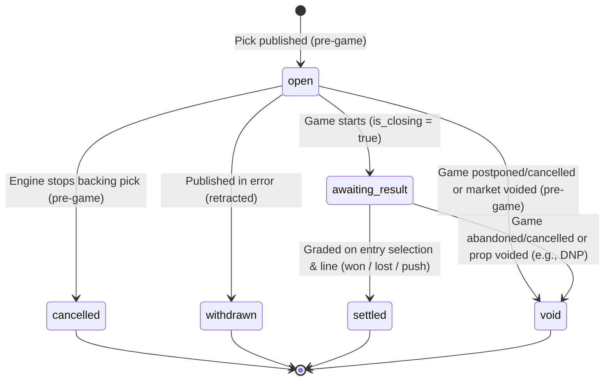

# Edge Picks v4: Producer Pick Record Schema & Contract Specification

Every v4-era Edge Pick (see [Section 1.3](#13-scope-coexistence--historical-picks)) is published as one strongly typed record per pick per region, using identical field names, units, and semantics across all sports and across both game picks and player prop picks. Downstream services (the BFF, the live edge monitor, and settlement) consume these records as the single source of truth; no consumer parses free-text descriptions or sport-specific structures to determine what a pick backs, how it is priced, or how it settled.

---

## 1. Document Control & Scope

| Attribute | Value |
| --- | --- |
| **Contract Version** | `4.0.0` |
| **Status** | Draft Specification, revision 2 (Oct 21, 2026). No producer emits this record yet: see [Section 12](#12-today-against-this-contract) |
| **Producers** | Sport bet engines (`nba`, `nfl`, `mlb`, `wnba`, `epl`) **compute** entry values; the Live Edge Monitor and Settlement **supply** observations and results; the **Publish Engine is the only writer** of pick records (see [Section 1.2](#12-storage-writers--field-ownership)) |
| **Consumers** | BFF (builds the app's Edge Picks API responses), Live Edge Monitor (tracks live market prices and edge states for open picks), and Settlement |
| **Contract Owner** | App / Platform Architecture (with sign-off from Bet Engine, Data Engineering, BFF, and Live Edge Monitor teams) |
| **Schema ID** | `https://contracts.xosports.ai/edge-picks/v4/producer-pick.schema.json` |
| **Store** | One record per Cosmos document in a dedicated container, `id = pick_id`, partition key `/game_sk` (KDD-001, Proposed) |
| **Related decisions & contracts** | KDD-001 (store and Publish Engine write path), KDD-002 (derived legacy documents, per-league cutover), KDD-003 (legacy/v4 coexistence, `era`) in `kdds.md`; BFF snapshot contract `bff-to-app-contract.md`; option-B v7 delivery plan `option-b-plan.md`; live overlays `realtime-overlays.md` |

### 1.1 What a Producer Pick Record Represents
A **producer pick record** represents a single betting recommendation on a specific market selection in a specific region (`"au"` or `"us"`) for a specific game (`game_sk`). It combines:
1. **Frozen entry state:** The exact selection, model probability, optional model projection, entry odds, entry edge, edge basis/threshold, and recommended stake at the moment the pick was first published.
2. **Live market observation state:** The most recent pre-game market price, line, bookmaker source, recalculated edge, and edge status observed after initial publication, culminating in the closing observation (`is_closing = true`) immediately before the game starts.
3. **Lifecycle and grading state:** The pick's current lifecycle state (`pick_status`), optional cancellation/void reason (`status_reason`), and final settlement grade (`outcome`) evaluated against the frozen entry selection and line.

### 1.2 Storage, Writers & Field Ownership

1. **Single writer.** Only the Publish Engine writes pick records. Bet engines, the Live Edge Monitor and Settlement are **value sources**: they hand values to the Publish Engine and never write a pick record directly.
2. **Store.** Each record is one Cosmos document in the dedicated pick-record container (KDD-001): document `id` = `pick_id`, partition key `/game_sk`. Cosmos system properties (`id`, `_rid`, `_etag`, `_ts`, …) are not part of the record; readers strip them before validating against [Section 9](#9-normative-json-schema-draft-2020-12).
3. **Write path.** For each pick the Publish Engine merges the engine's latest output, the latest monitor observation and any settlement result into one row, applies the merge rules in [Section 3.1](#31-merge--ordering-rules), validates the whole record against the JSON Schema, and upserts the whole document guarded by its etag (re-read, re-merge and retry on conflict). A record that fails validation fails the run; it is never skipped silently. Patch writes are not used (they cannot set a field to `null`).
4. **Cross-sport key uniqueness is a prerequisite.** Because `id = pick_id` begins with `game_sk` in a shared container, a `game_sk` must never be used by two sports. Until data engineering confirms the key ranges cannot overlap, producer CI rejects a `game_sk` the store already holds for another sport.

| Field group | Source of the value | Writer | Trigger |
| --- | --- | --- | --- |
| Identity, selection, model and entry fields (the 23 frozen fields, [Rule 3](#3-core-producer-rules)) | Bet engine run that first recommends the pick | Publish Engine, **first write only** | First publication |
| `current_*`, `observed_at`, `current_edge`, `edge_status` | Live Edge Monitor observation of the pick's market at the source named by `current_odds_source_kind`/`current_bookmaker_id` | Publish Engine | A changed observation, at most every 5 minutes per pick; delivered within 5 minutes ([Rule 5](#3-core-producer-rules)) |
| `is_closing` and `open` → `awaiting_result` | Schedule (`game_sk` start time) joined by the Publish Engine; the last pre-game observation is always written | Publish Engine | Game start |
| `cancelled`, `withdrawn` and their `status_reason` | Bet engine (explicit cancellation or withdrawal signal) | Publish Engine | Engine run |
| `settled`/`void`, `outcome`, `status_reason = "game_void"` | Settlement, grading on the frozen entry `side` and `line` | Publish Engine | After the game, or on postponement/cancellation |
| `rec_action` | Publish Engine from `current_edge` and the product thresholds (Open Decision D4) | Publish Engine | Each observation |
| `schema_version` | Publish Engine | Publish Engine | Every write |

### 1.3 Scope, Coexistence & Historical Picks

1. **Record family starts at a league cutover.** A league's picks become v4 records from that league's v4 start (KDD-002). The boundary is fixed per pick **at its first publication** and never changes afterwards. Whether the boundary is the pick's publication date (product requirement, "Historical Edge Picks") or its game's start (KDD-002) is Open Decision H1.
2. **No backfill, conversion or recalculation.** Picks published before the cutover are never converted into v4 records, never given placeholder values and never re-priced. Their legacy documents and ids are left untouched.
3. **Absence of a record means legacy.** A pick with no v4 record is a legacy pick. Consumers decide which card to draw from the consumer field `era` (`legacy` | `v4`, KDD-003), **never** from which v4 fields happen to be null. `era` is not a field of this record.
4. **Rule 2 is not a backfill mandate.** Persistence ([Rule 2](#3-core-producer-rules)) applies to records that exist; it never requires a v4 record for a legacy pick.

---

## 2. Data & Formatting Conventions

1. **Closed, fixed-key shape:** Every record contains all **37 fields** defined in this specification. No field is ever omitted; `"no value"` or `"not applicable"` is always represented as `null`. Producers must not emit undeclared fields (`"additionalProperties": false`), and consumers must ignore any unknown fields added in future minor (`4.x`) versions.
2. **Naming & casing:** All field names use `snake_case`. All enum values, `sport` codes, `region` codes, `stat_code` values, and bookmaker identifiers (`entry_bookmaker_id`, `current_bookmaker_id`) are lowercase strings.
3. **Numbers:** All numeric values are encoded as JSON numbers, never strings.
   - **Decimal odds** (`entry_decimal_odds`, `current_decimal_odds`) are strictly greater than `1.0` and carry **at most 4 decimal places** (e.g., `1.9091`, `2.0`, `3.6`).
   - **American odds** (`entry_american_odds`, `current_american_odds`) are integers (e.g., `-115`, `100`, `260`).
   - **Probabilities and edges** (`probability`, `entry_edge`, `edge_threshold`, `current_edge`) are expressed as **unitless fractions** (`0.05` for 5%), never percentage points (`5`) or strings (`"5%"`). A producer that works in percentage points recomputes the edge from the written values ([Section 5.1](#51-edge-basis--threshold-price-formulas)); it never divides a rounded percentage by 100.
   - **Rounding.** `probability` carries at most 4 decimal places. `entry_edge` and `current_edge` are computed from `probability` and the decimal odds **as written**, then rounded to **4 decimal places, half away from zero**.
4. **Timestamps:** All timestamps (`pick_date_time`, `observed_at`) are UTC ISO 8601 strings with millisecond precision and a trailing `Z` (e.g., `"2026-10-22T18:05:12.341Z"`). The JSON Schema enforces this with a `pattern`, not with `format` (which most validators treat as an annotation).
5. **Keys and codes:** `sport` is the **league code** (`"nba"`, never `"basketball"`). `game_sk`, `team_sk` and `player_sk` are the canonical schedule, team and player surrogate keys of the data platform; `game_sk` and `team_sk` are positive integers.
6. **Opaque identifiers:** Consumers treat `pick_id` as an opaque string identifier and never parse it. Producers construct `pick_id` deterministically using the formula in [Section 8](#8-deterministic-pick_id-specification).
7. **Semantic versioning:**
   - **Minor version (`4.x.0`):** Adding a new optional/nullable field or adding a new enum value is a minor version bump. Producers may emit new `4.x` values only after all consumers have deployed support for them. The market, `side` and `stat_code` vocabularies are versioned **with this schema**: a new market or stat code is a `4.x` minor bump (there is no separate taxonomy version).
   - **Major version (`5.0.0`):** Renaming or removing a field, changing a field's type or nullability, or changing a field's semantic meaning requires a major version bump.

---

## 3. Core Producer Rules

Every producer must uphold the following six invariants:

1. **Rule 1 — Deterministic, Region-Scoped Identity (`pick_id`):**
   `pick_id` is constructed using the canonical formula in [Section 8](#8-deterministic-pick_id-specification), making it globally unique across all sports and regions. Recommendations for the same selection in `"au"` and `"us"` are separate records with distinct `pick_id` values (`...|au` vs. `...|us`).
   - `pick_id` **never changes** when the market price or live line moves after publication.
   - If the engine recommends a different entry line (e.g., `-5.5` instead of `-4.5`), that is a separate pick with its own `pick_id`.
   - If the engine re-recommends the exact same selection and entry line in the same region after an earlier pick was `cancelled` or `withdrawn`, the new record receives a re-issue suffix (`|r2`, `|r3`, etc.). The re-issue number is **1 + the highest re-issue number already stored** for that selection and region (an unsuffixed id counts as 1); the Publish Engine determines it from the store.
   - If the engine re-recommends the same selection and entry line while the earlier pick is still `open`, that is the **same** record (an idempotent re-publish), never a new id or re-issue.
   - `pick_id` is at most 255 characters long and uses only characters from `A–Z`, `a–z`, `0–9`, and `_ . ~ | -`.
2. **Rule 2 — Persistence (No Silent Drops):**
   Once a pick record is written to the store it is never deleted, and no later run may fail to keep it: every pick moves only through its own status transitions, and records are retained after reaching a terminal state (`settled`, `void`, `cancelled`, or `withdrawn`). There is no TTL on pick records.
   - If the model or engine stops backing an `open` pick before the game starts, the engine must send an **explicit cancellation** for that `pick_id`, and the Publish Engine transitions the record to `pick_status = "cancelled"` with a `status_reason`. The record is **never** deleted or omitted.
   - **Absence is not a signal.** A pick missing from an engine run (a partial run, a paused job, a selector that keeps only the top picks) does not change the record; only an explicit cancellation or withdrawal does.
   - If a pick was published due to a system or data error, the producer transitions it to `pick_status = "withdrawn"`.
   - Re-running a model or pausing/disabling a producer stops new picks from being minted, but must never delete or overwrite already-published picks.
3. **Rule 3 — Frozen Entry State:**
   All identity, selection, model, and entry fields (`pick_id`, `region`, `sport`, `game_sk`, `pick_kind`, `market`, `side`, `line`, `team_sk`, `player_sk`, `stat_code`, `probability`, `projection_value`, `projection_unit`, `pick_date_time`, `entry_decimal_odds`, `entry_american_odds`, `entry_edge`, `edge_basis`, `edge_threshold`, `stake_units`, `odds_source_kind`, and `entry_bookmaker_id`) are **frozen at first publish** and must never change on subsequent updates. Subsequent writes may update only `schema_version`, `current_*` fields, `observed_at`, `is_closing`, `edge_status`, `rec_action`, `pick_status`, `status_reason`, and `outcome`.
4. **Rule 4 — Market Observation Timestamp (`observed_at`):**
   Whenever a record carries a live market observation, `observed_at` records the timestamp when the price (or pulled-price state) was observed at the sportsbook/feed—not the timestamp when the database write occurred.
5. **Rule 5 — One Writer, One Record & Closing Flag:**
   Only the Publish Engine writes pick records ([Section 1.2](#12-storage-writers--field-ownership)). Entry publication, pre-game market observations (delivered to the record within 5 minutes of observation), status transitions, and post-game settlement all reach the same record through the Publish Engine, never by a direct write, and never change frozen fields. `is_closing` is `false` while the game has not started; at game start the Publish Engine sets `is_closing = true` on the last pre-game observation (if one exists) in the same write that moves the pick to `awaiting_result`. A pick with no observation at game start moves to `awaiting_result` with `observed_at = null` and `is_closing = false`.
6. **Rule 6 — Forward-Only Lifecycle:**
   `pick_status` transitions strictly forward along the lifecycle defined in [Section 4](#4-pick-lifecycle-statuses--grading) (`open` $\to$ `awaiting_result` $\to$ `settled` or `void`; or pre-game `open` $\to$ `cancelled`, `void`, or `withdrawn`). A pick never moves backward to an earlier status. *(Whether a pre-game `cancelled` pick may reopen to `open` is tracked in [Section 11](#11-open-decisions--sign-off)).*

### 3.1 Merge & Ordering Rules

The Publish Engine applies these rules whenever more than one input reaches a pick (an engine run, an observation and a settlement result may arrive in the same run):

1. **Frozen fields are first-write-wins.** The 23 frozen fields are taken from the first write only; later engine output for the same `pick_id` never changes them, including `pick_date_time`.
2. **Status before observation.** Lifecycle and settlement transitions are applied before observations. An observation is applied only while `pick_status = "open"`, and the closing observation only in the write that moves the pick to `awaiting_result`.
3. **Terminal records are frozen.** Once `pick_status` is terminal, `current_*`, `observed_at`, `is_closing`, `current_edge`, `edge_status` and `rec_action` keep their last values; only `schema_version` may change.
4. **Observations move forward.** An observation older than the record's `observed_at` is discarded; `observed_at` never decreases.
5. **`is_closing` is one-way.** Once `true` it never returns to `false`. A postponed start before the game begins does not set it; a game that started is never "un-started".
6. **Idempotent re-publish.** Re-running an engine for a pick that is already stored changes nothing but allowed live fields; it never mints a new id, a re-issue suffix or a new `pick_date_time`.
7. **Forward-only status.** A transition that [Rule 6](#3-core-producer-rules) does not allow is rejected and fails the run.

---

## 4. Pick Lifecycle, Statuses & Grading

### 4.1 Lifecycle State Diagram



### 4.2 `pick_status` and `outcome` Specification

| `pick_status` | Phase | Meaning | Allowed `outcome` | Allowed `status_reason` | Consumer Behaviour |
| --- | --- | --- | --- | --- | --- |
| `"open"` | Pre-game | Active recommendation; the game has not started. | `null` | `null` | BFF serves the pick as open; live edge monitor tracks live odds. |
| `"awaiting_result"` | In-play / Post-game ungraded | The game has started and the pick has not yet been graded. | `null` | `null` | BFF serves the pick with its closing market observation (or with no current market if none was observed: `observed_at = null`, `is_closing = false`); live edge monitor stops watching. |
| `"cancelled"` | Pre-game (Terminal) | The bet engine stopped backing the pick before the game started. | `null` | **Required**: `"probability_moved"`, `"market_moved"` or `"lineup_change"` (the engine always knows why it cancelled; the card shows the reason) | BFF serves the pick as cancelled with its reason; live edge monitor stops watching and removes any live overlay. Never counts in settled win/loss records. |
| `"settled"` | Post-game (Terminal) | The game and market completed and the pick was graded against its frozen entry `line` and `side`. | `"won"`, `"lost"`, or `"push"` | `null` | BFF serves the final result (`won`, `lost`, or `push`). |
| `"void"` | Pre-game or Post-game (Terminal) | The game was postponed, cancelled, or abandoned, or the specific market/prop was voided under house rules. | `"void"` | Set when known (typically `"game_void"`), or `null` | BFF serves the pick as void; excluded from win/loss settlement totals. |
| `"withdrawn"` | Pre-game (Terminal) | The pick was published in error (data/pipeline defect) and retracted. | `null` | Optional (`"withdrawn"` or `null`) | BFF hides the pick and never serves it to clients; live edge monitor stops watching. |

> **Distinguishing `"push"` (`pick_status = "settled"`) from `"void"` (`pick_status = "void"`):**
> - Use **`pick_status = "settled"` with `outcome = "push"`** when the game and prop were validly played to completion and the final result landed **exactly on a whole-number entry `line`** (for example, a team backed at `-3.0` wins by exactly 3 points, or a total of `220.0` finishes with 220 total points).
> - Use **`pick_status = "void"` with `outcome = "void"`** when the wager itself is cancelled/voided without a valid contest—for example, when a game is postponed or cancelled (`status_reason = "game_void"`), or when a player prop is voided because the player did not play (DNP).

### 4.3 `status_reason` Codes (Provisional)

`status_reason` must be `null` whenever `pick_status` is `"open"`, `"awaiting_result"`, or `"settled"`. When `pick_status` is `"cancelled"`, it **must** carry one of the three cancellation codes below. When `pick_status` is `"void"` or `"withdrawn"`, it carries the matching code, or `null` if unknown:

| `status_reason` | Applicable `pick_status` | Meaning |
| --- | --- | --- |
| `"probability_moved"` | `"cancelled"` | A pre-game model re-evaluation lowered `probability` enough that the engine no longer backs the pick. |
| `"market_moved"` | `"cancelled"` | Pre-game price movement caused the bet engine to explicitly cancel its recommendation. |
| `"lineup_change"` | `"cancelled"` | A pre-game injury, scratch, or depth-chart change caused the bet engine to cancel the pick. |
| `"game_void"` | `"void"` | The game was postponed, cancelled, or abandoned, or the market was voided. A player prop voided because the player did not play (DNP) also uses `game_void` in `4.0.0`; a dedicated DNP code is Open Decision S3. |
| `"withdrawn"` | `"withdrawn"` | The pick was published in error and retracted. |

> **Important — Market movement vs. Cancellation:**
> - **`market_moved` is an explicit engine decision**, not a consequence of a price or line move: the engine may cancel because the market moved, but only by sending a cancellation with this reason.
> - **A line move alone never cancels a pick.** If the entry line was `-4.5` and the market moves to `-5.5`, the pick remains `pick_status = "open"` on its frozen entry line (`line = -4.5`), `current_line` updates to `-5.5`, `current_edge` becomes `null`, and `edge_status` becomes `"closed"`.
> - **`edge_status` never automatically changes `pick_status`.** Even if `edge_status` becomes `"closed"` or `"suspended"`, `pick_status` remains `"open"` unless the bet engine explicitly transitions `pick_status` to `"cancelled"`.

---

## 5. Edge Basis, Threshold, Threshold Price & Live Edge Status

### 5.1 Edge Basis & Threshold Price Formulas

A pick is published because its entry edge clears the producer's minimum threshold (`entry_edge > edge_threshold`) on the producer's chosen `edge_basis` (`"ev"` for Expected Value or `"prob"` for Probability Edge). Both `edge_basis` and `edge_threshold` are stored on the record so downstream services can deterministically compute the **threshold price** $b$, the narrowing midpoint price $m$, and live edge states.

> **Threshold price vs zero-edge price.** $b$ is the decimal price at which the edge **equals the producer's threshold $t$**. It equals the zero-edge (break-even) price $1/p$ only when $t = 0$; for $t > 0$ it is a shorter price than $1/p$. The zero-edge price $1/p$ is the same on both bases ($p \times d > 1 \iff p > 1/d$) and can be derived from `probability` alone. `edge_status = "closed"` (rule 4 below) means the price reached $b$, **not** that the edge stopped being positive; which boundary the app shows as "edge no longer available" is Open Decision D5.

Let:
- $p$ = `probability` ($0 < p < 1$)
- $d_{\text{entry}}$ = `entry_decimal_odds` ($d_{\text{entry}} > 1$, rounded to at most 4 decimal places)
- $d_{\text{curr}}$ = `current_decimal_odds` ($d_{\text{curr}} > 1$, rounded to at most 4 decimal places)
- $t$ = `edge_threshold` ($t \ge 0$, expressed as a fraction)

| Metric | Expected-Value Basis (`edge_basis = "ev"`) | Probability Basis (`edge_basis = "prob"`) | Rounding & Constraints |
| --- | --- | --- | --- |
| **`entry_edge`** | $p \times d_{\text{entry}} - 1$ | $p - \dfrac{1}{d_{\text{entry}}}$ | Computed from `probability` and `entry_decimal_odds` **as written on the record** (never from unrounded internal floats), rounded to 4 dp half away from zero. Must satisfy `entry_edge > edge_threshold` (and therefore `entry_edge > 0`) — **strictly greater**: an engine whose selection filter is `>=` must either change it to `>` or write the threshold it actually applies. |
| **`current_edge`** | $p \times d_{\text{curr}} - 1$ | $p - \dfrac{1}{d_{\text{curr}}}$ | Computed only when `current_decimal_odds != null` **and** `current_line == line` (including when both `line` and `current_line` are `null`). If `current_decimal_odds == null` or `current_line != line`, `current_edge` **must be `null`**. |
| **Threshold price ($b$)** | $b = \dfrac{1 + t}{p}$ | $b = \dfrac{1}{p - t}$ *(undefined if $p \le t$)* | Computed from unrounded $p$ and $t$, then **rounded down (floor)** to 4 decimal places. |
| **Narrowing midpoint price ($m$)** | $m = \dfrac{d_{\text{entry}} + b}{2}$ | $m = \dfrac{d_{\text{entry}} + b}{2}$ | Computed from unrounded inputs, then rounded to 4 decimal places **half away from zero**. |

### 5.2 Decimal-to-American Odds Conversion

American odds (`entry_american_odds`, `current_american_odds`) are derived from the corresponding decimal price $d$, rounded to the nearest integer **half away from zero**:
- When $d \ge 2.0$: $\text{American} = +\text{round}\big((d - 1) \times 100\big)$
- When $1.0 < d < 2.0$: $\text{American} = -\text{round}\!\left(\dfrac{100}{d - 1}\right)$

### 5.3 `edge_status` Decision Table (First Match Wins)

Whenever a record is written, `edge_status` is determined by evaluating the following rules in strict priority order (**first match wins**):

| Priority | Condition | `edge_status` | `current_edge` | Meaning |
| --- | --- | --- | --- | --- |
| **1** | `observed_at == null` | `null` | `null` | No live market observation has been recorded yet. |
| **2** | `observed_at != null` and `current_decimal_odds == null` | `"suspended"` | `null` | The bookmaker pulled the market or price at the latest observation (`current_american_odds` and `current_line` are also `null`). |
| **3** | `current_line != line` | `"closed"` | `null` | The market line has moved off the pick's frozen entry `line`. |
| **4** | `current_decimal_odds <= b` | `"closed"` | Number ($\le t$) | The price on the entry line has moved to or below the threshold price $b$. |
| **5** | `entry_decimal_odds > b` and `current_decimal_odds <= m` | `"narrowing"` | Number ($> t$) | The price on the entry line has decayed past the midpoint $m$ toward the threshold price $b$, though positive edge remains. |
| **6** | Otherwise (`current_decimal_odds > m`) | `"live"` | Number ($> t$) | The pick's edge remains healthy above the midpoint $m$. |

### 5.4 Additional Producer Calculation Rules
- **Blended model probabilities:** `probability` is the exact probability value on which the pick was selected. If an engine blends its raw model probability toward the no-vig market probability before selection, it writes the blended value to `probability`.
- **Additional selection filters:** Any secondary selection filters (such as maximum model-vs-market disagreement caps or stake-tier bands) govern whether a pick is emitted and what `stake_units` it receives; they do not alter $b$, $m$, or `edge_status`.
- **Display conversion:** Producers never convert edges to the mobile app's display basis; the BFF performs display conversion from `probability` and the decimal price.
- **Authority of stored edge values (Provisional, Open Decision D3):** `entry_edge`, `current_edge` and `edge_status` are authoritative **on the producer's `edge_basis`**. Consumers that display a different basis recompute from `probability` and the written prices with these same formulas, and report any disagreement between a stored `edge_status` and their own recomputation as a defect rather than silently preferring one.
- **Whole-number lines:** on a line where a push is possible (e.g. total `220.0`, spread `-3.0`), `probability` is the probability that the backed side **wins**, excluding the push; $b$, $m$ and the edge formulas use it unchanged (a push returns the stake and is neither a win nor a loss). Whether producers should instead write a push-adjusted probability is Open Decision E2.
- **Line moves:** in `4.0.0`, `current_edge` is `null` whenever `current_line != line`, because the record carries no probability at the new line. Showing an updated edge after a line move (the redesign's "Updated Edge") needs a new field and is Open Decision D2.

### 5.5 Normative Calculation Test Vectors

| Vector | Input Parameters | Expected Output |
| --- | --- | --- |
| **P-1** | `edge_basis = "ev"`, `probability = 0.58`, `entry_decimal_odds = 1.9091` | `entry_edge = 0.1073` |
| **P-2** | `edge_basis = "prob"`, `probability = 0.58`, `entry_decimal_odds = 1.9091` | `entry_edge = 0.0562` |
| **P-3** | Engine computes `5.0` percentage points on `"prob"` basis | `entry_edge = 0.05` |
| **P-4** | `edge_basis = "ev"`, `probability = 0.55`, `edge_threshold = 0` | $b = 1.8181$ (`-122` American); with $t = 0$ this is also the zero-edge price |
| **P-5** | `edge_basis = "prob"`, `probability = 0.55`, `edge_threshold = 0.03` | $b = 1.9230$ (threshold price; the zero-edge price is $1/p = 1.8181$) |
| **P-6** | `edge_basis = "prob"`, `probability = 0.40`, `edge_threshold = 0.03`, `entry_decimal_odds = 3.0000` | `entry_edge = 0.0667`, $b = 2.7027$ (`+170`), $m = 2.8514$ |
| **P-7** | `edge_basis = "ev"`, `probability = 0.55`, `edge_threshold = 0`, `entry_decimal_odds = 2.0000`, `line = 24.5`; observed `current_decimal_odds = 1.9500`, `current_line = 24.5` | `current_edge = 0.0725`, `edge_status = "live"` ($b = 1.8181$, $m = 1.9091$) |
| **P-8** | Same as **P-7**, except observed `current_line = 25.5` | `current_edge = null`, `edge_status = "closed"` |
| **P-9** | Decimal odds `1.8696` | American odds `-115` |

---

## 6. Field Reference (All 37 Fields)

Every producer pick record contains all 37 fields listed below. **Frozen** fields keep their first-publish value for the life of the record; **Live** fields are updated as market observations arrive or when the pick changes status / settles.

### 6.1 Identity & Context Fields

| # | Field | JSON Type | Allowed Values / Format | Null When | Mutability | Definition |
| --- | --- | --- | --- | --- | --- | --- |
| 1 | `schema_version` | `string` | SemVer matching `^4\.\d+\.\d+$` (e.g., `"4.0.0"`) | Never | Per write | Version of this contract the record conforms to. |
| 2 | `pick_id` | `string` | Canonical ID (max 255 chars; see [Section 8](#8-deterministic-pick_id-specification)) | Never | Frozen | Globally unique identifier for this pick in this region. |
| 3 | `region` | `string` | `"au"`, `"us"` | Never | Frozen | Target region for which the pick and its sportsbook pricing were published. |
| 4 | `sport` | `string` | `"nba"`, `"nfl"`, `"mlb"`, `"wnba"`, `"epl"` | Never | Frozen | League code of the game (not the sport family: `"nba"`, never `"basketball"`). |
| 5 | `game_sk` | `integer` | Positive integer (`>= 1`) | Never | Frozen | Canonical surrogate key of the game in the schedule. Must not collide across sports ([Section 1.2](#12-storage-writers--field-ownership)). |
| 6 | `pick_kind` | `string` | `"game"`, `"player"` | Never | Frozen | Whether this is a game-level pick (`"game"`) or a player prop (`"player"`). Explicitly stated, never inferred. |

### 6.2 Selection Fields (Frozen)

| # | Field | JSON Type | Allowed Values / Format | Null When | Mutability | Definition |
| --- | --- | --- | --- | --- | --- | --- |
| 7 | `market` | `string` | `"moneyline"`, `"spread"`, `"total"`, `"draw"`, `"btts"`, `"player_prop"` | Never | Frozen | Betting market. Must be `"player_prop"` iff `pick_kind == "player"`. |
| 8 | `side` | `string` | `"home"`, `"away"`, `"over"`, `"under"`, `"yes"`, `"no"`, `"draw"` | Never | Frozen | Backed side of the market (see [Section 7.1](#71-market--selection-matrix)). |
| 9 | `line` | `number \| null` | Signed number for `"spread"`; positive number (`> 0`) for `"total"` and `"over"`/`"under"` `"player_prop"` | `market` is `"moneyline"`, `"draw"`, `"btts"`, or a `"yes"`/`"no"` `"player_prop"` | Frozen | Entry line or threshold. For `"spread"`, expressed from the backed team's perspective (negative when giving points, positive when receiving points). |
| 10 | `team_sk` | `integer \| null` | Positive integer (`>= 1`): canonical surrogate key of the backed team | `market` is `"total"`, `"draw"`, `"btts"`, or `"player_prop"` | Frozen | Surrogate key of the backed team (`"moneyline"` and `"spread"` only). |
| 11 | `player_sk` | `integer \| null` | Integer: canonical surrogate key of the player (positivity is Open Decision K1) | `pick_kind == "game"` | Frozen | Surrogate key of the subject player (`"player_prop"` only). |
| 12 | `stat_code` | `string \| null` | Lowercase identifier matching `^[a-z][a-z0-9_]*$` (see [Section 7.3](#73-supported-markets--stat_code-vocabulary-by-sport-provisional)) | `pick_kind == "game"` | Frozen | Stat category being wagered on (`"player_prop"` only, e.g., `"pts"`, `"rec_yds"`). |

### 6.3 Model & Entry Pricing Fields (Frozen)

| # | Field | JSON Type | Allowed Values / Format | Null When | Mutability | Definition |
| --- | --- | --- | --- | --- | --- | --- |
| 13 | `probability` | `number` | `0 < probability < 1` | Never | Frozen | Model win probability (as a fraction) on which the pick was selected. |
| 14 | `projection_value` | `number \| null` | Finite JSON number (e.g., `28.3`) | The model produces no numeric projection for this market (always for `"moneyline"`, `"draw"`, `"btts"` and yes/no props) | Frozen | Model's projection for the backed selection, per [Section 7.5](#75-projections-provisional). Must be `null` iff `projection_unit` is `null`. |
| 15 | `projection_unit` | `string \| null` | Non-empty string from [Section 7.5](#75-projections-provisional) (e.g., `"points"`, `"yards"`, `"runs"`) | `projection_value == null` | Frozen | Unit label accompanying `projection_value`. |
| 16 | `pick_date_time` | `string` | ISO 8601 UTC timestamp (`YYYY-MM-DDTHH:mm:ss.sssZ`) | Never | Frozen | **Provisional (Open Decision P1):** the recommendation time of the bet engine run that first produced the pick (the app's "Predicted at"), carried unchanged by the Publish Engine on first write and never changed by later runs or merges. |
| 17 | `entry_decimal_odds` | `number` | `> 1.0` (at most 4 decimal places) | Never | Frozen | Decimal price at first publish. |
| 18 | `entry_american_odds` | `integer` | Integer (derived from `entry_decimal_odds` per [Section 5.2](#52-decimal-to-american-odds-conversion)) | Never | Frozen | American price at first publish. |
| 19 | `entry_edge` | `number` | `> 0` (fraction; must exceed `edge_threshold`) | Never | Frozen | Edge at first publish computed on `edge_basis` from `probability` and `entry_decimal_odds`. |
| 20 | `edge_basis` | `string` | `"ev"`, `"prob"` | Never | Frozen | Formula basis (`"ev"` or `"prob"`) used to select the pick and evaluate `entry_edge` and `current_edge`. |
| 21 | `edge_threshold` | `number` | `>= 0` (fraction, e.g., `0`, `0.03`) | Never | Frozen | Minimum edge threshold $t$ on `edge_basis` that `entry_edge` cleared at selection time. |
| 22 | `stake_units` | `number` | `>= 0` (e.g., `0.5`, `1`, `2`) | Never | Frozen | Recommended stake size in units. |
| 23 | `odds_source_kind` | `string` | `"bookmaker"`, `"market_average"` | Never | Frozen | Whether the entry price came from a specific bookmaker or a market average. |
| 24 | `entry_bookmaker_id` | `string \| null` | Lowercase slug matching `^[a-z0-9_]+$` (e.g., `"fanduel"`, `"draftkings"`, `"sportsbet"`) | `odds_source_kind == "market_average"` | Frozen | Identifier of the sportsbook supplying the entry price. Must be a string when `odds_source_kind == "bookmaker"`. |

### 6.4 Live Market Observation Fields (Live)

| # | Field | JSON Type | Allowed Values / Format | Null When | Mutability | Definition |
| --- | --- | --- | --- | --- | --- | --- |
| 25 | `current_decimal_odds` | `number \| null` | `> 1.0` (at most 4 decimal places) | `observed_at == null`, or the bookmaker pulled the price (`edge_status == "suspended"`) | Live | Latest observed decimal price for the pick's market. |
| 26 | `current_american_odds` | `integer \| null` | Integer (derived from `current_decimal_odds`) | `current_decimal_odds == null` | Live | Latest observed American price. |
| 27 | `current_line` | `number \| null` | Signed number for `"spread"`; `> 0` for `"total"` and `"over"`/`"under"` `"player_prop"` | `observed_at == null`, `line == null` (market has no line), or `current_decimal_odds == null` (price pulled) | Live | Latest observed line. Must be non-null whenever `current_decimal_odds != null` and `line != null`. |
| 28 | `current_odds_source_kind` | `string \| null` | `"bookmaker"`, `"market_average"` | `observed_at == null` | Live | Source kind of the latest market observation (remains non-null even when the price is pulled at that source). |
| 29 | `current_bookmaker_id` | `string \| null` | Lowercase slug matching `^[a-z0-9_]+$` | `observed_at == null` or `current_odds_source_kind == "market_average"` | Live | Sportsbook where the latest market observation was taken. |
| 30 | `observed_at` | `string \| null` | ISO 8601 UTC timestamp (`YYYY-MM-DDTHH:mm:ss.sssZ`); never decreases | No market observation has occurred yet | Live | Timestamp when the latest price (or pulled-price state) was observed at the sportsbook. |
| 31 | `is_closing` | `boolean` | `true`, `false` | Never (`false` when `observed_at == null`) | Live | `true` only on the final pre-game market observation, set by the Publish Engine at game start; `false` otherwise. Never `true` while `pick_status` is `"open"`, `"cancelled"` or `"withdrawn"`; once `true`, never returns to `false`. |
| 32 | `current_edge` | `number \| null` | Number (fraction; may be negative if price deteriorated) | `current_decimal_odds == null` or `current_line != line` | Live | Edge on `edge_basis` at `current_decimal_odds`, computed only while `current_line == line`. |
| 33 | `edge_status` | `string \| null` | `"live"`, `"narrowing"`, `"closed"`, `"suspended"` | `observed_at == null` | Live | Classification of the pick's live edge at the latest observation (see [Section 5.3](#53-edge_status-decision-table-first-match-wins)). |
| 34 | `rec_action` | `string \| null` | `"play"`, `"watch"`, `"pass"` | Until product thresholds are agreed (Open Decision D4), and whenever `current_edge` is `null` | Live | Recommended action for the bettor derived from `current_edge` and the agreed thresholds. Typed as an enum now so that populating it is not a breaking change; producers write `null` until D4 is decided. |

### 6.5 Lifecycle & Settlement Fields (Live)

| # | Field | JSON Type | Allowed Values / Format | Null When | Mutability | Definition |
| --- | --- | --- | --- | --- | --- | --- |
| 35 | `pick_status` | `string` | `"open"`, `"awaiting_result"`, `"cancelled"`, `"settled"`, `"void"`, `"withdrawn"` | Never | Live | Current lifecycle state of the pick (see [Section 4.2](#42-pick_status-and-outcome-specification)). |
| 36 | `status_reason` | `string \| null` | `"probability_moved"`, `"market_moved"`, `"lineup_change"`, `"withdrawn"`, `"game_void"` | `pick_status` is `"open"`, `"awaiting_result"`, or `"settled"`; or `pick_status` is `"void"`/`"withdrawn"` and no reason is known. **Never null when `pick_status` is `"cancelled"`.** | Live | Machine-readable reason why a pick was `cancelled`, `void`, or `withdrawn` (see [Section 4.3](#43-status_reason-codes-provisional)). |
| 37 | `outcome` | `string \| null` | `"won"`, `"lost"`, `"push"`, `"void"` | `pick_status` is `"open"`, `"awaiting_result"`, `"cancelled"`, or `"withdrawn"` | Live | Final settlement grade evaluated on the frozen entry selection and line (`"won" \| "lost" \| "push"` when `pick_status == "settled"`; `"void"` when `pick_status == "void"`). |

---

## 7. Game Picks, Player Picks & Market Rules

A single record structure carries both game picks (`pick_kind = "game"`) and player prop picks (`pick_kind = "player"`). The combination of `pick_kind`, `market`, `side`, `line`, `team_sk`, `player_sk`, and `stat_code` completely defines the selection.

### 7.1 Market & Selection Matrix

| `market` | `pick_kind` | Allowed `side` | `line` | `team_sk` | `player_sk` & `stat_code` |
| --- | --- | --- | --- | --- | --- |
| `"moneyline"` | `"game"` | `"home"` or `"away"` | `null` | Integer (`> 0`, backed team) | `null` |
| `"spread"` | `"game"` | `"home"` or `"away"` | Number (signed from backed team's view; negative when giving points) | Integer (`> 0`, backed team) | `null` |
| `"total"` | `"game"` | `"over"` or `"under"` | Number (`> 0`, total points/runs/goals threshold) | `null` | `null` |
| `"draw"` | `"game"` | `"draw"` | `null` | `null` | `null` |
| `"btts"` | `"game"` | `"yes"` or `"no"` | `null` | `null` | `null` |
| `"player_prop"` *(threshold)* | `"player"` | `"over"` or `"under"` | Number (`> 0`, stat threshold; `current_line` must also be `> 0` when present) | `null` | Integer `player_sk` and non-empty string `stat_code` |
| `"player_prop"` *(binary)* | `"player"` | `"yes"` or `"no"` | `null` (`current_line` must also be `null`) | `null` | Integer `player_sk` and non-empty string `stat_code` |

### 7.2 Domain Rules for Selections & Lines

1. **`side = "home" | "away"` comes from the game venue, not schedule slot order:**
   A producer that internally labels teams as `team_1`/`team_2` or `favourite`/`underdog` must resolve whether the backed team is the home team or the away team for `side`, and write that team's surrogate key to `team_sk`.
2. **Three-way moneyline in soccer (`sport = "epl"`):**
   In sports with regulation draws (`"epl"`), `"moneyline"` (`"home"` or `"away"`) is a 3-way regulation market that loses if the match finishes in a draw; backing the draw itself uses `market = "draw"` with `side = "draw"`.
3. **Milestone player props (`"25+ points"`):**
   Milestone props for $k+$ units are normalized to `market = "player_prop"`, `side = "over"`, and `line = k - 0.5` (for example, `"25+ points"` is written as `side = "over"`, `line = 24.5`).
4. **Binary (`"yes"` / `"no"`) player props:**
   Yes/no props (such as NFL `"anytime_td"`) use `market = "player_prop"`, `side = "yes"` or `"no"`, and `line = null` (never `line = 0.5`).
5. **Full-game regulation/standard settlement, one line per pick:**
   Version `4.0` covers full-game markets only (no halves, quarters, or periods). Alternate lines are represented simply by their `line` value with no separate flag. Quarter lines (Asian handicap `0.25` / `0.75` steps that split stakes) are not permitted.
6. **Edge consistency with written odds:**
   `entry_edge` must be computed from `probability` and `entry_decimal_odds` **as rounded and written in the record** (up to 4 decimal places), ensuring any consumer recomputing `entry_edge` reproduces the exact same value.

### 7.3 Supported Markets & `stat_code` Vocabulary by Sport (Provisional)

| `sport` | Supported Game Markets (`pick_kind = "game"`) | Supported Player Prop `stat_code` Values (`pick_kind = "player"`, `market = "player_prop"`) | Prop `side` & `line` Type |
| --- | --- | --- | --- |
| **`"nba"`** | `"moneyline"`, `"spread"`, `"total"` | `"pts"` (points), `"reb"` (rebounds), `"ast"` (assists), `"threes"` (three-pointers made) | `"over"` / `"under"` with `line > 0` |
| **`"nfl"`** | `"moneyline"`, `"spread"`, `"total"` | `"pass_yds"` (passing yards), `"pass_tds"` (passing touchdowns), `"rush_yds"` (rushing yards), `"rec_yds"` (receiving yards), `"receptions"` (receptions) | `"over"` / `"under"` with `line > 0` |
| **`"nfl"`** *(binary)* | — | `"anytime_td"` (anytime touchdown scorer) | `"yes"` / `"no"` with `line = null` |
| **`"mlb"`** *(batters)* | `"moneyline"`, `"total"` *(plus `"spread"` run-line when enabled)* | `"hits"` (batter hits), `"runs"` (runs scored), `"home_runs"` (home runs), `"rbi"` (runs batted in) | `"over"` / `"under"` with `line > 0` |
| **`"mlb"`** *(pitchers)* | — | `"strikeouts"` (pitcher strikeouts), `"hits_allowed"` (hits allowed), `"earned_runs"` (earned runs allowed) | `"over"` / `"under"` with `line > 0` |
| **`"wnba"`** | `"moneyline"`, `"total"` *(plus `"spread"` when enabled)* | None in `4.0.0` (WNBA player props exist in production and in the redesign; adding them is Open Decision M1) | — |
| **`"epl"`** | `"moneyline"` (3-way), `"draw"`, `"btts"`, `"total"`, `"spread"` | None in `4.0.0` (Anytime Goalscorer is in the redesign; Open Decision M1) | — |

**Vocabulary check.** Producer CI rejects any record whose `sport`/`market`/`stat_code` combination is not in this table ([Section 9.1](#91-cross-record--arithmetic-invariants-checked-alongside-json-schema), invariant 9). Asian Handicap is not a `4.0.0` market; quarter lines remain excluded ([Section 7.2](#72-domain-rules-for-selections--lines), rule 5).

**Written today as** (for producers migrating): NBA stats are already `pts`, `reb`, `ast`, `threes`. NFL writes `PaYDs`, `PaTDs`, `RuYDs`, `RecYDs`, `REC` and `TD` (as `player_yes`/`player_no` with line `0.5`; v4 uses `line = null`). MLB writes `H`, `R`, `HR`, `RBI`, `K`, `HA`, `ER` (one doc example uses `H` for both hits and hits allowed).

### 7.4 How Each League's Picks Map onto the Record

Observed at `app-data` dev `2b6f998` and `nba_bet_engine` dev `3bfbb8b` (Oct 19, 2026); see [Section 12](#12-today-against-this-contract).

| League and type | Written today | Becomes |
| --- | --- | --- |
| NBA game (WLTP) | market `h2h`, `spread` or `total`; selection `t1`, `t2`, `over` or `under`; numeric line | `moneyline`, `spread` or `total`; `t1`/`t2` becomes `home`/`away` of that team (from the venue, rule 7.2.1); over/under unchanged |
| NBA player (PS) | market `prop`; type `player_over`/`player_under`; stat `pts`, `reb`, `ast` or `threes`; numeric line | `player_prop`; `over`/`under`; `stat_code` unchanged |
| NFL game | type `H2H`, `spread_fav`, `spread_dog`, `higher_TP`, `lower_TP`; team only in `bet_line` (`T1_…`/`T2_…`); line as a string in `bookmaker.position` | `moneyline`; `spread` on the side of the team in `bet_line`; `total` over/under |
| MLB game | type `H2H`, `higher_TP`, `lower_TP` | `moneyline`; `total` |
| WNBA game | type `H2H`, `higher_TP`, `lower_TP` | `moneyline`; `total` |
| EPL game | type `H2H`, `DRAW`, `BTTS_YES`, `BTTS_NO`, `higher_TP`, `lower_TP`, `spread_fav`, `spread_dog` | `moneyline` (3-way), `draw`, `btts` yes/no, `total`, `spread` |
| NFL player | type `player_over`, `player_under`, `player_yes`, `player_no`; stat `PaYDs` etc.; line as a string | `player_prop`; over/under/yes/no; `stat_code` per [Section 7.3](#73-supported-markets--stat_code-vocabulary-by-sport-provisional); `line = null` for yes/no |
| MLB player | type `player_over`/`player_under`; stat `H`, `R`, `HR`, `RBI`, `K`, `HA`, `ER` | `player_prop`; `stat_code` per Section 7.3 |
| WNBA player | raw copy with no document type; no consumer reads it | Nothing until Open Decision M1 |
| EPL player | none | Nothing until Open Decision M1 |

### 7.5 Projections (Provisional)

`projection_value` is the model's projection **for the backed selection**, in the unit given by `projection_unit`:

| `market` | `projection_value` | `projection_unit` |
| --- | --- | --- |
| `"total"` | Projected combined score | `"points"` (nba, wnba, nfl), `"runs"` (mlb), `"goals"` (epl) |
| `"spread"` | Projected margin **from the backed team's view** (positive = the backed team wins by that much; comparable to `-line`) | Same as `"total"` |
| `"player_prop"` over/under | Projected stat value (expected value of the stat) | The stat's unit: `"points"`, `"rebounds"`, `"assists"`, `"three_pointers"`, `"yards"`, `"touchdowns"`, `"receptions"`, `"hits"`, `"runs"`, `"home_runs"`, `"rbi"`, `"strikeouts"`, `"hits_allowed"`, `"earned_runs"` |
| `"moneyline"`, `"draw"`, `"btts"`, yes/no props | `null` | `null` |

### 7.6 Selection & `pick_id` Examples Across Sports

*(In the examples below, the home team is the schedule's `team_1` (`t1`) and the away team is `team_2` (`t2`); see [Section 8](#8-deterministic-pick_id-specification) for how `t1`/`t2` is used in `pick_id`.)*

| # | Scenario | `pick_kind` | `market` | `side` | `line` | `team_sk` | `player_sk` | `stat_code` | Canonical `pick_id` |
| --- | --- | --- | --- | --- | --- | --- | --- | --- | --- |
| **G1** | NBA: Celtics `-4.5` (home, `team_1`) | `"game"` | `"spread"` | `"home"` | `-4.5` | `40000002` | `null` | `null` | `{game_sk}\|spread_t1\|t1\|-4.5\|main\|full\|{region}` |
| **G2** | NBA: Over `224.5` total points | `"game"` | `"total"` | `"over"` | `224.5` | `null` | `null` | `null` | `{game_sk}\|total_over\|over\|224.5\|main\|full\|{region}` |
| **G3** | NBA: Knicks moneyline (away, `team_2`) | `"game"` | `"moneyline"` | `"away"` | `null` | `40000018` | `null` | `null` | `{game_sk}\|h2h_t2\|t2\|null\|main\|full\|{region}` |
| **G4** | EPL: Match draw | `"game"` | `"draw"` | `"draw"` | `null` | `null` | `null` | `null` | `{game_sk}\|draw_draw\|draw\|null\|main\|full\|{region}` |
| **G5** | EPL: Both teams to score — No | `"game"` | `"btts"` | `"no"` | `null` | `null` | `null` | `null` | `{game_sk}\|btts_no\|no\|null\|main\|full\|{region}` |
| **G6** | EPL: Home team 3-way moneyline (`team_1`) | `"game"` | `"moneyline"` | `"home"` | `null` | `50000001` | `null` | `null` | `{game_sk}\|h2h_t1\|t1\|null\|main\|full\|{region}` |
| **G7** | NFL: Away underdog `+6.5` (`team_2`) | `"game"` | `"spread"` | `"away"` | `6.5` | `30000014` | `null` | `null` | `{game_sk}\|spread_t2\|t2\|6.5\|main\|full\|{region}` |
| **G8** | MLB: Under `8.5` total runs | `"game"` | `"total"` | `"under"` | `8.5` | `null` | `null` | `null` | `{game_sk}\|total_under\|under\|8.5\|main\|full\|{region}` |
| **P1** | NBA: Jayson Tatum Over `24.5` points | `"player"` | `"player_prop"` | `"over"` | `24.5` | `null` | `400000000434` | `"pts"` | `{game_sk}\|{player_sk}\|pts\|player_over\|24.5\|main\|full\|{region}` |
| **P2** | NBA: Player Under `9.5` rebounds | `"player"` | `"player_prop"` | `"under"` | `9.5` | `null` | `400000000434` | `"reb"` | `{game_sk}\|{player_sk}\|reb\|player_under\|9.5\|main\|full\|{region}` |
| **P3** | NFL: Player Over `14.5` receiving yards | `"player"` | `"player_prop"` | `"over"` | `14.5` | `null` | `300123456` | `"rec_yds"` | `{game_sk}\|{player_sk}\|rec_yds\|player_over\|14.5\|main\|full\|{region}` |
| **P4** | NFL: Player Anytime Touchdown — Yes | `"player"` | `"player_prop"` | `"yes"` | `null` | `null` | `300123456` | `"anytime_td"` | `{game_sk}\|{player_sk}\|anytime_td\|player_yes\|null\|main\|full\|{region}` |
| **P5** | MLB: Aaron Judge Over `0.5` home runs | `"player"` | `"player_prop"` | `"over"` | `0.5` | `null` | `20009911` | `"home_runs"` | `{game_sk}\|{player_sk}\|home_runs\|player_over\|0.5\|main\|full\|{region}` |
| **P6** | NBA: Player `25+` points milestone | `"player"` | `"player_prop"` | `"over"` | `24.5` | `null` | `400000000434` | `"pts"` | `{game_sk}\|{player_sk}\|pts\|player_over\|24.5\|main\|full\|{region}` |

---

## 8. Deterministic `pick_id` Specification

Every producer builds `pick_id` using one canonical pipe-delimited (`|`) formula. While consumers treat `pick_id` as an opaque identifier and never parse it, the deterministic formula guarantees that every producer mints the exact same ID for the same pick and prevents collisions across games, markets, lines, and regions.

### 8.1 Canonical Templates

| Pick Category | Canonical `pick_id` Template |
| --- | --- |
| **Game pick (`pick_kind = "game"`)** | `{game_sk}\|{market_token}_{selection}\|{selection}\|{line_token}\|main\|full\|{region}` |
| **Player prop (`pick_kind = "player"`)** | `{game_sk}\|{player_sk}\|{stat_code}\|player_{side}\|{line_token}\|main\|full\|{region}` |
| **Re-issued pick (either kind)** | Same template above, followed by `\|r{n}` (where `n >= 2`, starting at `r2`) |

### 8.2 Segment Definitions

| Segment | Specification |
| --- | --- |
| `game_sk`, `player_sk`, `stat_code`, `region` | Exact string representation of the record's own `game_sk`, `player_sk`, `stat_code`, and `region` fields. |
| `market_token` *(game picks)* | `"h2h"` when `market == "moneyline"`; otherwise the record's `market` value (`"spread"`, `"total"`, `"draw"`, `"btts"`). Any future market token added in `4.x` must consist of lowercase ASCII letters and digits only (`[a-z0-9]+`), with no `_` or `\|`. |
| `selection` *(game picks)* | When `team_sk != null` (`"moneyline"` and `"spread"`), `"t1"` or `"t2"`—the backed team's slot (`team_1` or `team_2`) on the game schedule, matched by `team_sk`. When `team_sk == null` (`"total"`, `"draw"`, `"btts"`), the record's `side` (`"over"`, `"under"`, `"draw"`, `"yes"`, `"no"`). |
| `selection` *(reserved multi-way)* | Reserved for future `4.x` multi-way markets: `k{competitor_sk}` for a team/competitor among a field (e.g., tournament winner) and `p{player_sk}` for a player among all players in a game (e.g., first touchdown scorer). Not emitted in `4.0.0`. |
| `side` *(player props)* | The record's `side` (`"over"`, `"under"`, `"yes"`, `"no"`), prefixed with `player_` (`player_over`, `player_under`, `player_yes`, `player_no`). Because milestone props are represented as `side = "over"` with `line = k - 0.5`, they always use `player_over`. |
| `line_token` | `"null"` when `line == null`. Otherwise, the shortest decimal string that parses back to the exact same floating-point number, always including at least one digit after the decimal point: `"24.5"`, `"-4.5"`, `"3.0"`, `"220.0"`. Zero is `"0.0"`, never `"-0.0"`. |
| `main`, `full` | Literal constants `"main"` and `"full"` in `4.x` (representing main/alternate unified line treatment and full-game regulation period). |
| `r{n}` *(re-issue suffix)* | Omitted on first publication of a selection in a region. If that pick is `cancelled` or `withdrawn` and a later pre-game run recommends the exact same selection and entry line in the same region, the new pick appends `\|r2` (then `\|r3`, etc.). |

> **Why `side` uses `"home" | "away"` while `pick_id` uses `"t1" | "t2"`:**
> On the record itself, `side` (`"home"` or `"away"`) gives consumers the semantic venue side without needing to cross-reference the schedule. In `pick_id`, `"t1"` / `"t2"` binds identity to the game schedule's `team_1_sk` / `team_2_sk` slots, so NBA game-pick ids already published in this form keep their exact spelling.

### 8.2.1 Identity Rules

1. **Compatibility is limited to ids already in this form.** NBA game-pick and player-prop ids that already follow these templates keep their spelling. Ids in other forms are **legacy ids**, not v4 ids: the generic `{game_sk}*{bet_type}*{region}` form used by NFL/MLB/WNBA/EPL game picks, NBA `player_milestone` and `alternate`-variant ids (336 of 1,070 dev NBA ids measured on Oct 20 fail the v4 pattern), and the WNBA player-pick id. **Old ids are never rewritten**; a legacy pick keeps its legacy id (KDD-002, KDD-003).
2. **`h2h` marks moneyline, and nothing else.** Older app builds recognise a moneyline pick by `h2h` in its id and keep only one side of a game's moneyline in a slip. No other market token may contain `h2h`.
3. **Unique across sports.** See [Section 1.2](#12-storage-writers--field-ownership), item 4.
4. **The selection is the id without its region.** Removing `|{region}` and any `|r{n}` gives the selection key, which `au` and `us` records on the same line share and which settlement grades once.
5. **Re-issue numbers come from the store.** `n` is 1 + the highest re-issue number already stored for the same selection key and region ([Rule 1](#3-core-producer-rules)). When checking [Section 9.1](#91-cross-record--arithmetic-invariants-checked-alongside-json-schema) invariant 1, `n` is read back from the id's `|r{n}` suffix.
6. **Reopening.** If cancelled picks may return to `open` (Open Decision L2), the cancelled record reopens under its own id and no re-issue is minted.

### 8.3 Concrete `pick_id` Examples

| Pick Description | `pick_id` |
| --- | --- |
| NBA spread on `team_1` (`-4.5`, US) | `40021717862\|spread_t1\|t1\|-4.5\|main\|full\|us` |
| NBA moneyline on `team_1` (AU) | `40021717862\|h2h_t1\|t1\|null\|main\|full\|au` |
| NBA player prop (`pts` Over `24.5`, US) | `40021717862\|400000000434\|pts\|player_over\|24.5\|main\|full\|us` |
| NFL spread on `team_2` on a whole-number line (`+3.0`, US) | `300019484\|spread_t2\|t2\|3.0\|main\|full\|us` |
| EPL match draw (AU) | `500000123\|draw_draw\|draw\|null\|main\|full\|au` |
| EPL both teams to score — No (AU) | `500000123\|btts_no\|no\|null\|main\|full\|au` |
| NFL anytime touchdown — Yes (US) | `300019484\|300123456\|anytime_td\|player_yes\|null\|main\|full\|us` |
| NBA total Over `224.5` re-issued after a cancellation (US) | `40021717862\|total_over\|over\|224.5\|main\|full\|us\|r2` |
| Reserved (`4.x`): Tournament winner (`competitor_sk = 3301`) | `7001234\|winner_k3301\|k3301\|null\|main\|full\|us` |
| Reserved (`4.x`): First touchdown scorer (`player_sk = 300123456`) | `300019484\|firsttd_p300123456\|p300123456\|null\|main\|full\|us` |

### 8.4 Reference `pick_id` Generator (Python)

Producers written in any language must produce output identical to this reference function:

```python
MARKET_TOKEN = {
    "moneyline": "h2h",
    "spread": "spread",
    "total": "total",
    "draw": "draw",
    "btts": "btts",
}


def line_token(line):
    if line is None:
        return "null"
    x = float(line)
    return repr(0.0 if x == 0 else x)  # e.g. "24.5", "-4.5", "3.0", "220.0"


def build_pick_id(record, team_slot=None, reissue=1):
    """
    team_slot: "t1" or "t2" (the backed team's slot on the game schedule);
               required whenever record["team_sk"] is not None.
    reissue:   1 for first issue; 2, 3, ... for re-issues after cancelled/withdrawn.
    """
    r = record
    if r["pick_kind"] == "player":
        parts = [
            r["game_sk"],
            r["player_sk"],
            r["stat_code"],
            "player_" + r["side"],
        ]
    else:
        selection = team_slot if r["team_sk"] is not None else r["side"]
        parts = [
            r["game_sk"],
            MARKET_TOKEN[r["market"]] + "_" + selection,
            selection,
        ]
    parts += [line_token(r["line"]), "main", "full", r["region"]]
    if reissue > 1:
        parts.append(f"r{reissue}")
    return "|".join(str(p) for p in parts)
```

---

## 9. Normative JSON Schema (Draft 2020-12)

The JSON Schema below is self-contained and is the normative machine-verifiable specification for a single producer pick record. It enforces:
- All 37 required fields and `"additionalProperties": false`
- Positive `game_sk` and `team_sk`, non-empty `projection_unit`, and the UTC millisecond `Z` timestamp shape (by `pattern`, so it does not depend on a validator's `format` support)
- Lifecycle pairings: `is_closing` is `false` while `open`, `cancelled` or `withdrawn`; `cancelled` requires a cancellation reason; `void`/`withdrawn` reasons; `rec_action` is `null` whenever `current_edge` is `null`; `current_edge` is present whenever a price is observed on a market without a line
- Field types, numeric bounds, regex patterns, and enum vocabularies
- Co-nullability and conditional rules for market observations, pulled prices (`edge_status = "suspended"`), bookmaker vs. market-average sources, game vs. player picks, market-to-side/line/team mappings, positive lines on totals and over/under props, and `projection_value`/`projection_unit` pairing

```json
{
  "$schema": "https://json-schema.org/draft/2020-12/schema",
  "$id": "https://contracts.xosports.ai/edge-picks/v4/producer-pick.schema.json",
  "title": "Edge Picks producer pick record 4.0.0 (draft revision 2)",
  "type": "object",
  "required": [
    "schema_version",
    "pick_id",
    "region",
    "sport",
    "game_sk",
    "pick_kind",
    "market",
    "side",
    "line",
    "team_sk",
    "player_sk",
    "stat_code",
    "probability",
    "projection_value",
    "projection_unit",
    "pick_date_time",
    "entry_decimal_odds",
    "entry_american_odds",
    "entry_edge",
    "edge_basis",
    "edge_threshold",
    "stake_units",
    "odds_source_kind",
    "entry_bookmaker_id",
    "current_decimal_odds",
    "current_american_odds",
    "current_line",
    "current_odds_source_kind",
    "current_bookmaker_id",
    "observed_at",
    "is_closing",
    "current_edge",
    "edge_status",
    "rec_action",
    "pick_status",
    "status_reason",
    "outcome"
  ],
  "properties": {
    "schema_version": {"type": "string", "pattern": "^4\\.\\d+\\.\\d+$"},
    "pick_id": {
      "type": "string",
      "maxLength": 255,
      "pattern": "^(\\d+\\|[a-z0-9]+_(t1|t2|over|under|yes|no|draw|k\\d+|p\\d+)\\|(t1|t2|over|under|yes|no|draw|k\\d+|p\\d+)\\|(null|0\\.0|-?[1-9]\\d*\\.(0|\\d*[1-9])|-?0\\.\\d*[1-9])\\|main\\|full\\|(au|us)(\\|r([2-9]|[1-9]\\d+))?|\\d+\\|\\d+\\|[a-z0-9_]+\\|player_(over|under|yes|no)\\|(null|0\\.0|-?[1-9]\\d*\\.(0|\\d*[1-9])|-?0\\.\\d*[1-9])\\|main\\|full\\|(au|us)(\\|r([2-9]|[1-9]\\d+))?)$"
    },
    "region": {"enum": ["au", "us"]},
    "sport": {"enum": ["nba", "nfl", "mlb", "wnba", "epl"]},
    "game_sk": {"type": "integer", "minimum": 1},
    "pick_kind": {"enum": ["game", "player"]},
    "market": {"enum": ["moneyline", "spread", "total", "draw", "btts", "player_prop"]},
    "side": {"enum": ["home", "away", "over", "under", "yes", "no", "draw"]},
    "line": {"type": ["number", "null"]},
    "team_sk": {"type": ["integer", "null"], "minimum": 1},
    "player_sk": {"type": ["integer", "null"]},
    "stat_code": {"type": ["string", "null"], "pattern": "^[a-z][a-z0-9_]*$"},
    "probability": {"type": "number", "exclusiveMinimum": 0, "exclusiveMaximum": 1},
    "projection_value": {"type": ["number", "null"]},
    "projection_unit": {"type": ["string", "null"], "minLength": 1},
    "pick_date_time": {"type": "string", "format": "date-time", "pattern": "^\\d{4}-\\d{2}-\\d{2}T\\d{2}:\\d{2}:\\d{2}\\.\\d{3}Z$"},
    "entry_decimal_odds": {"type": "number", "exclusiveMinimum": 1},
    "entry_american_odds": {"type": "integer"},
    "entry_edge": {"type": "number", "exclusiveMinimum": 0},
    "edge_basis": {"enum": ["ev", "prob"]},
    "edge_threshold": {"type": "number", "minimum": 0},
    "stake_units": {"type": "number", "minimum": 0},
    "odds_source_kind": {"enum": ["bookmaker", "market_average"]},
    "entry_bookmaker_id": {"type": ["string", "null"], "pattern": "^[a-z0-9_]+$"},
    "current_decimal_odds": {"type": ["number", "null"], "exclusiveMinimum": 1},
    "current_american_odds": {"type": ["integer", "null"]},
    "current_line": {"type": ["number", "null"]},
    "current_odds_source_kind": {"enum": ["bookmaker", "market_average", null]},
    "current_bookmaker_id": {"type": ["string", "null"], "pattern": "^[a-z0-9_]+$"},
    "observed_at": {"type": ["string", "null"], "format": "date-time", "pattern": "^\\d{4}-\\d{2}-\\d{2}T\\d{2}:\\d{2}:\\d{2}\\.\\d{3}Z$"},
    "is_closing": {"type": "boolean"},
    "current_edge": {"type": ["number", "null"]},
    "edge_status": {"enum": ["live", "narrowing", "closed", "suspended", null]},
    "rec_action": {"enum": ["play", "watch", "pass", null]},
    "pick_status": {"enum": ["open", "awaiting_result", "cancelled", "settled", "void", "withdrawn"]},
    "status_reason": {"enum": ["probability_moved", "market_moved", "lineup_change", "withdrawn", "game_void", null]},
    "outcome": {"enum": ["won", "lost", "push", "void", null]}
  },
  "allOf": [
    {
      "if": {"properties": {"current_decimal_odds": {"type": "number"}}},
      "then": {"properties": {"observed_at": {"type": "string"}, "current_american_odds": {"type": "integer"}}}
    },
    {
      "if": {"properties": {"current_decimal_odds": {"type": "number"}, "line": {"type": "number"}}},
      "then": {"properties": {"current_line": {"type": "number"}}}
    },
    {
      "if": {"properties": {"observed_at": {"type": "null"}}},
      "then": {
        "properties": {
          "current_decimal_odds": {"type": "null"},
          "current_american_odds": {"type": "null"},
          "current_line": {"type": "null"},
          "current_odds_source_kind": {"type": "null"},
          "current_bookmaker_id": {"type": "null"},
          "current_edge": {"type": "null"},
          "edge_status": {"type": "null"},
          "is_closing": {"const": false}
        }
      },
      "else": {"properties": {"edge_status": {"type": "string"}, "current_odds_source_kind": {"type": "string"}}}
    },
    {
      "if": {"properties": {"odds_source_kind": {"const": "bookmaker"}}},
      "then": {"properties": {"entry_bookmaker_id": {"type": "string"}}},
      "else": {"properties": {"entry_bookmaker_id": {"type": "null"}}}
    },
    {
      "if": {"properties": {"pick_status": {"const": "settled"}}},
      "then": {"properties": {"outcome": {"enum": ["won", "lost", "push"]}}}
    },
    {
      "if": {"properties": {"pick_status": {"const": "void"}}},
      "then": {"properties": {"outcome": {"const": "void"}}}
    },
    {
      "if": {"properties": {"pick_status": {"enum": ["open", "awaiting_result", "cancelled", "withdrawn"]}}},
      "then": {"properties": {"outcome": {"const": null}}}
    },
    {
      "if": {"properties": {"pick_status": {"enum": ["open", "awaiting_result", "settled"]}}},
      "then": {"properties": {"status_reason": {"const": null}}}
    },
    {
      "if": {"properties": {"pick_kind": {"const": "player"}}},
      "then": {
        "properties": {
          "market": {"const": "player_prop"},
          "player_sk": {"type": "integer"},
          "stat_code": {"type": "string"}
        }
      },
      "else": {
        "properties": {
          "market": {"not": {"const": "player_prop"}},
          "player_sk": {"type": "null"},
          "stat_code": {"type": "null"}
        }
      }
    },
    {
      "if": {"properties": {"market": {"enum": ["moneyline", "spread"]}}},
      "then": {"properties": {"side": {"enum": ["home", "away"]}, "team_sk": {"type": "integer"}}}
    },
    {
      "if": {"properties": {"market": {"enum": ["spread", "total"]}}},
      "then": {"properties": {"line": {"type": "number"}}}
    },
    {
      "if": {"properties": {"market": {"enum": ["moneyline", "draw", "btts"]}}},
      "then": {"properties": {"line": {"type": "null"}}}
    },
    {
      "if": {"properties": {"market": {"const": "total"}}},
      "then": {"properties": {"side": {"enum": ["over", "under"]}, "team_sk": {"type": "null"}}}
    },
    {
      "if": {"properties": {"market": {"const": "draw"}}},
      "then": {"properties": {"side": {"const": "draw"}, "team_sk": {"type": "null"}}}
    },
    {
      "if": {"properties": {"market": {"const": "btts"}}},
      "then": {"properties": {"side": {"enum": ["yes", "no"]}, "team_sk": {"type": "null"}}}
    },
    {
      "if": {"properties": {"market": {"const": "player_prop"}}},
      "then": {"properties": {"side": {"enum": ["over", "under", "yes", "no"]}, "team_sk": {"type": "null"}}}
    },
    {
      "if": {"properties": {"market": {"const": "player_prop"}, "side": {"enum": ["over", "under"]}}},
      "then": {"properties": {"line": {"type": "number"}}}
    },
    {
      "if": {"properties": {"side": {"enum": ["yes", "no"]}}},
      "then": {"properties": {"line": {"type": "null"}}}
    },
    {
      "if": {"properties": {"observed_at": {"type": "string"}, "current_decimal_odds": {"type": "null"}}},
      "then": {
        "properties": {
          "current_american_odds": {"type": "null"},
          "current_line": {"type": "null"},
          "current_edge": {"type": "null"},
          "edge_status": {"const": "suspended"}
        }
      }
    },
    {
      "if": {"properties": {"edge_status": {"const": "suspended"}}},
      "then": {"properties": {"current_decimal_odds": {"type": "null"}}}
    },
    {
      "if": {"properties": {"current_odds_source_kind": {"const": "bookmaker"}}},
      "then": {"properties": {"current_bookmaker_id": {"type": "string"}}},
      "else": {"properties": {"current_bookmaker_id": {"type": "null"}}}
    },
    {
      "if": {"properties": {"market": {"enum": ["total", "player_prop"]}, "side": {"enum": ["over", "under"]}}},
      "then": {"properties": {"line": {"exclusiveMinimum": 0}, "current_line": {"exclusiveMinimum": 0}}}
    },
    {
      "if": {"properties": {"line": {"type": "null"}}},
      "then": {"properties": {"current_line": {"type": "null"}}}
    },
    {
      "if": {"properties": {"projection_value": {"type": "null"}}},
      "then": {"properties": {"projection_unit": {"type": "null"}}},
      "else": {"properties": {"projection_unit": {"type": "string"}}}
    },
    {
      "if": {"properties": {"pick_status": {"enum": ["open", "cancelled", "withdrawn"]}}},
      "then": {"properties": {"is_closing": {"const": false}}}
    },
    {
      "if": {"properties": {"pick_status": {"const": "cancelled"}}},
      "then": {"properties": {"status_reason": {"enum": ["probability_moved", "market_moved", "lineup_change"]}}}
    },
    {
      "if": {"properties": {"pick_status": {"const": "void"}}},
      "then": {"properties": {"status_reason": {"enum": ["game_void", null]}}}
    },
    {
      "if": {"properties": {"pick_status": {"const": "withdrawn"}}},
      "then": {"properties": {"status_reason": {"enum": ["withdrawn", null]}}}
    },
    {
      "if": {"properties": {"current_edge": {"type": "null"}}},
      "then": {"properties": {"rec_action": {"const": null}}}
    },
    {
      "if": {"properties": {"line": {"type": "null"}, "current_decimal_odds": {"type": "number"}}},
      "then": {"properties": {"current_edge": {"type": "number"}}}
    }
  ],
  "additionalProperties": false
}
```

### 9.1 Cross-Record & Arithmetic Invariants (Checked Alongside JSON Schema)

Because JSON Schema validates one JSON object at a time and cannot compare two fields, producer test suites (and the Publish Engine before each write) also enforce these invariants that span fields or consecutive publishes:
1. **`pick_id` reconstruction:** Rebuilding `pick_id` from the record's fields, the game schedule (for the `t1`/`t2` slot) and the re-issue number read back from the id's `|r{n}` suffix, using `build_pick_id()` ([Section 8.4](#84-reference-pick_id-generator-python)), yields the exact `pick_id` on the record. The slot must belong to `team_sk`, and `side` must be that team's venue side.
2. **Decimal places:** `entry_decimal_odds` and `current_decimal_odds` have at most 4 decimal places.
3. **Arithmetic consistency:** `entry_edge > edge_threshold` (strictly), and `entry_edge`, `current_edge`, `edge_status`, `entry_american_odds`, and `current_american_odds` match the formulas and rounding in [Section 5](#5-edge-basis-threshold-threshold-price--live-edge-status). In particular `current_edge` is a number whenever `current_decimal_odds != null` and `current_line == line`, and `null` otherwise.
4. **No silent drops (Rule 2):** Every `pick_id` in the store remains in the store; a record changes status only through an explicit transition, never because a run omitted it.
5. **Frozen-field immutability (Rule 3):** For any existing `pick_id`, all 23 frozen fields are byte-for-byte identical to their first-publish values.
6. **Forward-only status transitions (Rule 6):** `pick_status` transitions only along valid edges in [Section 4.1](#41-lifecycle-state-diagram).
7. **Observation ordering (Section 3.1):** `observed_at` never decreases; `is_closing` never returns from `true` to `false`; no live field changes after a terminal status.
8. **Uniqueness:** one record per `pick_id` in a run's output and in the store; no `game_sk` shared by two sports.
9. **Vocabulary:** the `sport`/`market`/`stat_code` combination is listed in [Section 7.3](#73-supported-markets--stat_code-vocabulary-by-sport-provisional).
10. **Timestamps:** `pick_date_time` is unchanged after first write; `observed_at`, when set, is not later than the write time and not earlier than `pick_date_time`.

---

## 10. Complete Example Records

All five records below validate against the normative JSON Schema in [Section 9](#9-normative-json-schema-draft-2020-12) (revision 2) and satisfy all arithmetic and `pick_id` invariants.

### 10.1 Example 1 — Newly Published Open Player Prop (`nba`, `"prob"` basis, no observation yet)
Jayson Tatum Over `24.5` points in the `"us"` region on the probability basis (`probability = 0.6565`, `entry_decimal_odds = 1.87`, `edge_threshold = 0.03`, giving `entry_edge = 0.6565 - 1/1.87 = 0.1217`), before the live edge monitor has recorded its first observation:

```json
{
  "schema_version": "4.0.0",
  "pick_id": "40021717862|400000000434|pts|player_over|24.5|main|full|us",
  "region": "us",
  "sport": "nba",
  "game_sk": 40021717862,
  "pick_kind": "player",
  "market": "player_prop",
  "side": "over",
  "line": 24.5,
  "team_sk": null,
  "player_sk": 400000000434,
  "stat_code": "pts",
  "probability": 0.6565,
  "projection_value": null,
  "projection_unit": null,
  "pick_date_time": "2026-10-22T03:00:00.000Z",
  "entry_decimal_odds": 1.87,
  "entry_american_odds": -115,
  "entry_edge": 0.1217,
  "edge_basis": "prob",
  "edge_threshold": 0.03,
  "stake_units": 1,
  "odds_source_kind": "bookmaker",
  "entry_bookmaker_id": "fanduel",
  "current_decimal_odds": null,
  "current_american_odds": null,
  "current_line": null,
  "current_odds_source_kind": null,
  "current_bookmaker_id": null,
  "observed_at": null,
  "is_closing": false,
  "current_edge": null,
  "edge_status": null,
  "rec_action": null,
  "pick_status": "open",
  "status_reason": null,
  "outcome": null
}
```

### 10.2 Example 2 — Newly Published Open Game Pick (`epl`, `"draw"`, `"ev"` basis, `"au"` region)
An EPL match draw in the `"au"` region on the expected-value basis (`probability = 0.30`, `entry_decimal_odds = 3.60`, `edge_threshold = 0`, giving `entry_edge = 0.30 * 3.60 - 1 = 0.08`):

```json
{
  "schema_version": "4.0.0",
  "pick_id": "500000123|draw_draw|draw|null|main|full|au",
  "region": "au",
  "sport": "epl",
  "game_sk": 500000123,
  "pick_kind": "game",
  "market": "draw",
  "side": "draw",
  "line": null,
  "team_sk": null,
  "player_sk": null,
  "stat_code": null,
  "probability": 0.3,
  "projection_value": null,
  "projection_unit": null,
  "pick_date_time": "2026-10-22T06:00:00.000Z",
  "entry_decimal_odds": 3.6,
  "entry_american_odds": 260,
  "entry_edge": 0.08,
  "edge_basis": "ev",
  "edge_threshold": 0,
  "stake_units": 0.5,
  "odds_source_kind": "bookmaker",
  "entry_bookmaker_id": "sportsbet",
  "current_decimal_odds": null,
  "current_american_odds": null,
  "current_line": null,
  "current_odds_source_kind": null,
  "current_bookmaker_id": null,
  "observed_at": null,
  "is_closing": false,
  "current_edge": null,
  "edge_status": null,
  "rec_action": null,
  "pick_status": "open",
  "status_reason": null,
  "outcome": null
}
```

### 10.3 Example 3 — Open Game Pick with Live Market Observation (`nba`, `"spread"`, `edge_status = "live"`)
An NBA home spread pick (`line = -4.5`) on the expected-value basis (`probability = 0.55`, `edge_threshold = 0`, $b = 1.8181$, $m = 1.9091$). Entry price `2.0000` gives `entry_edge = 0.1000`. The latest observation sees `current_decimal_odds = 1.9500` on the same `-4.5` line, giving `current_edge = 0.0725` and `edge_status = "live"` (since `1.9500 > 1.9091`):

```json
{
  "schema_version": "4.0.0",
  "pick_id": "40021717862|spread_t1|t1|-4.5|main|full|us",
  "region": "us",
  "sport": "nba",
  "game_sk": 40021717862,
  "pick_kind": "game",
  "market": "spread",
  "side": "home",
  "line": -4.5,
  "team_sk": 40000002,
  "player_sk": null,
  "stat_code": null,
  "probability": 0.55,
  "projection_value": null,
  "projection_unit": null,
  "pick_date_time": "2026-10-22T18:05:12.341Z",
  "entry_decimal_odds": 2.0,
  "entry_american_odds": 100,
  "entry_edge": 0.1,
  "edge_basis": "ev",
  "edge_threshold": 0,
  "stake_units": 2,
  "odds_source_kind": "bookmaker",
  "entry_bookmaker_id": "draftkings",
  "current_decimal_odds": 1.95,
  "current_american_odds": -105,
  "current_line": -4.5,
  "current_odds_source_kind": "bookmaker",
  "current_bookmaker_id": "draftkings",
  "observed_at": "2026-10-22T18:58:40.000Z",
  "is_closing": false,
  "current_edge": 0.0725,
  "edge_status": "live",
  "rec_action": null,
  "pick_status": "open",
  "status_reason": null,
  "outcome": null
}
```

### 10.4 Example 4 — Pre-Game Cancelled Game Pick (`nba`, `"moneyline"`, `status_reason = "probability_moved"`)
An away moneyline pick (`entry_decimal_odds = 2.25`, `probability = 0.48`, `entry_edge = 0.08`, $b = 2.0833$). Before tip-off, a model re-evaluation stopped backing the pick, transitioning `pick_status` to `"cancelled"` with `status_reason = "probability_moved"`. All frozen fields (`probability`, `entry_*`) retain their first-publish values, and `current_*` retains the final market observation taken before cancellation (`2.05`, where `current_edge = -0.016` and `edge_status = "closed"`):

```json
{
  "schema_version": "4.0.0",
  "pick_id": "40021717861|h2h_t2|t2|null|main|full|us",
  "region": "us",
  "sport": "nba",
  "game_sk": 40021717861,
  "pick_kind": "game",
  "market": "moneyline",
  "side": "away",
  "line": null,
  "team_sk": 40000013,
  "player_sk": null,
  "stat_code": null,
  "probability": 0.48,
  "projection_value": null,
  "projection_unit": null,
  "pick_date_time": "2026-10-22T14:02:10.500Z",
  "entry_decimal_odds": 2.25,
  "entry_american_odds": 125,
  "entry_edge": 0.08,
  "edge_basis": "ev",
  "edge_threshold": 0,
  "stake_units": 1,
  "odds_source_kind": "bookmaker",
  "entry_bookmaker_id": "draftkings",
  "current_decimal_odds": 2.05,
  "current_american_odds": 105,
  "current_line": null,
  "current_odds_source_kind": "bookmaker",
  "current_bookmaker_id": "draftkings",
  "observed_at": "2026-10-22T18:41:00.000Z",
  "is_closing": false,
  "current_edge": -0.016,
  "edge_status": "closed",
  "rec_action": null,
  "pick_status": "cancelled",
  "status_reason": "probability_moved",
  "outcome": null
}
```

### 10.5 Example 5 — Settled Player Prop After a Pre-Game Line Move (`nba`, `"player_prop"`, `is_closing = true`, `outcome = "won"`)
Tyrese Maxey Over `26.5` points (`entry_decimal_odds = 1.8696`, `probability = 0.60`, `entry_edge = 0.1218`, `projection_value = 28.3`, `projection_unit = "points"`). By the closing observation before tip-off (`is_closing = true`), the sportsbook line had moved to `27.5` (`current_line = 27.5`), setting `current_edge = null` and `edge_status = "closed"`. Because a line move never cancels a pick, the recommendation stayed active on its entry line (`26.5`), was graded post-game against `26.5`, and settled as `"won"`:

```json
{
  "schema_version": "4.0.0",
  "pick_id": "40021717850|50001234|pts|player_over|26.5|main|full|us",
  "region": "us",
  "sport": "nba",
  "game_sk": 40021717850,
  "pick_kind": "player",
  "market": "player_prop",
  "side": "over",
  "line": 26.5,
  "team_sk": null,
  "player_sk": 50001234,
  "stat_code": "pts",
  "probability": 0.6,
  "projection_value": 28.3,
  "projection_unit": "points",
  "pick_date_time": "2026-10-22T13:10:44.002Z",
  "entry_decimal_odds": 1.8696,
  "entry_american_odds": -115,
  "entry_edge": 0.1218,
  "edge_basis": "ev",
  "edge_threshold": 0,
  "stake_units": 2,
  "odds_source_kind": "bookmaker",
  "entry_bookmaker_id": "draftkings",
  "current_decimal_odds": 1.9091,
  "current_american_odds": -110,
  "current_line": 27.5,
  "current_odds_source_kind": "bookmaker",
  "current_bookmaker_id": "draftkings",
  "observed_at": "2026-10-22T15:59:30.000Z",
  "is_closing": true,
  "current_edge": null,
  "edge_status": "closed",
  "rec_action": null,
  "pick_status": "settled",
  "status_reason": null,
  "outcome": "won"
}
```

---

## 11. Open Decisions & Sign-Off

### 11.1 Open Contract Decisions

Each row states the provisional rule this draft uses and who decides. Rows marked **blocks sign-off** must be settled before the contract is signed; the others can be signed provisionally and changed in a `4.x` minor version.

| ID | Topic | Provisional rule in this draft | Open question | Decides | Target | Impact |
| --- | --- | --- | --- | --- | --- | --- |
| S1 | **Status vocabulary** | `open`, `awaiting_result`, `cancelled`, `settled`, `void`, `withdrawn` | Final names and the `cancelled`/`withdrawn` boundary | Bet engine, BFF, monitor | Oct 21, 2026 | Blocks sign-off |
| L2 | **Reopening a `cancelled` pick** | Disallowed (Rule 6); re-recommendations mint `\|r{n}` | Whether a pre-game `cancelled` pick may return to `open` under its own id (the NFL engine reinstates players who climb back up the depth chart) | Bet engine, product | Oct 21, 2026 | Blocks sign-off |
| S2 | **`status_reason` vocabulary** | `probability_moved`, `market_moved`, `lineup_change`, `withdrawn`, `game_void`; required on `cancelled` | Drop `withdrawn` as a reason; add `book_pulled`, `competitor_withdrawn` | Bet engine | Oct 21, 2026 | |
| S3 | **DNP void reason** | A DNP prop void uses `game_void` | Add a dedicated `player_dnp` code | Bet engine, settlement | Oct 30, 2026 | |
| V1 | **`stat_code` vocabulary** | [Section 7.3](#73-supported-markets--stat_code-vocabulary-by-sport-provisional) | Final codes and any `4.x` additions | Bet engine | Oct 21, 2026 | |
| M1 | **Market scope for the redesign** | EPL and WNBA have no player props; no Asian Handicap | Add EPL Anytime Goalscorer, WNBA player props, Asian Handicap (quarter lines stay excluded); also resolve the baseline page's "EPL publishes no picks" | Product | Oct 30, 2026 | |
| C1 | **Pre-game cancellation policy** (specs D14) | Engine cancels only when it stops backing a pick, by explicit signal; never for a line move alone | Which re-evaluations cancel (size of probability move, market move, lineup change, book pulled) per sport, and who owns the lineup feed | Bet engine, product | Oct 30, 2026 | |
| D2 | **Updated edge after a line move** | `current_edge = null`, `edge_status = "closed"` when `current_line != line` | The redesign shows an edge recomputed at the new line. Either add a nullable probability/edge at the current line (minor, new fields, owned by the engine or monitor) or descope the "Updated Edge" after a move | Product, bet engine, monitor | Oct 23, 2026 | Blocks the redesign as designed |
| D3 | **Edge authority and display basis** | Stored values are authoritative on the producer's basis; consumers recompute for display and report disagreements ([Section 5.4](#54-additional-producer-calculation-rules)) | The app's single display basis (provisional: EV) | Product, BFF | Oct 23, 2026 | |
| D4 | **Recommended Action thresholds** | `rec_action` is `null` until decided | Play/Watch/Pass thresholds on `current_edge`. The mock shows "Wait" (not in the requirement's vocabulary) on a **positive** +3% edge, so Play needs a threshold above zero | Product | Nov 2, 2026 | Blocks the redesign as designed |
| D5 | **"Edge no longer available" boundary** | `edge_status = "closed"` at the threshold price $b$ | Whether the app shows availability at zero edge ($1/p$) or at $b$; the requirement says "positive". If zero, consumers must not map `edge_status` straight to "edge no longer available" | Product, BFF | Oct 23, 2026 | |
| E1 | **Edge rounding and threshold strictness** | 4 dp half away from zero; `entry_edge > edge_threshold` strictly; `probability` at most 4 dp | Confirm; engines currently filter `>=` (e.g. NBA tiered 8.0 pp, PS 3 pp) | Bet engine | Oct 23, 2026 | |
| E2 | **Probability on whole-number lines** | `probability` excludes the push ([Section 5.4](#54-additional-producer-calculation-rules)) | Whether producers should write a push-adjusted probability instead | Bet engine | Oct 30, 2026 | |
| P1 | **Meaning of `pick_date_time`** | The engine's recommendation time on the first run that produced the pick | Confirm against the requirement ("the date/time the Edge Pick was generated") and the Publish Engine merge | Product, bet engine | Oct 23, 2026 | |
| R1 | **AU region semantics** | An AU record states its true source: a real AU book (`odds_source_kind = "bookmaker"`) or a computed market average (`"market_average"`, no bookmaker id); it never names a US book under `au` | What price an AU record carries (US mirror, computed average, or a new AU feed). Today the NBA engine copies the US pick into AU while the app labels every AU pick "Avg. Odds" | Product, bet engine | Oct 30, 2026 | Blocks AU records |
| R2 | **Reference-data owners** | — | Owner of the bookmaker slug → display name registry and the `stat_code` → label registry (the BFF's is NBA-only) | Data engineering, BFF | Oct 30, 2026 | |
| K1 | **`player_sk` positivity** | Not required | Whether player surrogate keys are positive by convention (then add `minimum: 1`) | Data engineering | Oct 30, 2026 | |
| K2 | **Cross-sport `game_sk` uniqueness** | Producer CI rejects a `game_sk` held by another sport | Data-engineering commitment that key ranges never overlap | Data engineering | With KDD-001 | Blocks the store |
| H1 | **Historical cutover boundary** | Fixed per pick at first publication ([Section 1.3](#13-scope-coexistence--historical-picks)) | Publication date (product requirement) or game start (KDD-002); and whether a legacy card may show a recomputed edge (KDD-003) when the requirement says no recalculation | Product, BFF | Oct 23, 2026 | Blocks sign-off |
| W1 | **Store and write path** | [Section 1.2](#12-storage-writers--field-ownership) (KDD-001, Proposed) | Container name per environment; KDD-001 acceptance | Bet engine, data engineering | With KDD-001 | Blocks sign-off |
| W2 | **Observation path** | Monitor → Publish Engine, at most every 5 minutes, last pre-game observation always written | Who computes `current_edge`/`edge_status` for NBA, MLB, WNBA and EPL (specs D7) and which feed carries observations into the Publish Engine | Monitor, bet engine | Nov 2, 2026 | |

### 11.2 Change Log & Sign-Off

| Date | Version | Summary | Sign-Off Status |
| --- | --- | --- | --- |
| Oct 19, 2026 | `4.0.0` | Initial self-contained v4.0.0 specification of the Edge Picks producer pick record schema, lifecycle, edge formulas, market/stat mappings, deterministic `pick_id`, and Draft 2020-12 JSON Schema. | **Bet Engine:** Pending<br>**Data Engineering:** Pending<br>**BFF:** Pending<br>**Live Edge Monitor:** Pending |
| Oct 21, 2026 | `4.0.0` draft revision 2 | From the producer-contract assessment (`conf-schema-contracts-assessment.md`). **Restored** from the earlier edition: Publish Engine as the single writer, the store, cross-sport key uniqueness, `h2h`-only-for-moneyline, "old ids are never rewritten", the league mapping, "written today as" stat codes, "Today against this contract" and the BFF status crosswalk (which KDD-003 cites). **Added:** field ownership (1.2), historical scope and coexistence (1.3), merge and ordering rules (3.1), explicit cancellation signal, re-issue numbering, projection conventions (7.5), invariants 7–10, and open decisions D2–D5, E1–E2, P1, R1–R2, K1–K2, H1, W1–W2, M1, S3. **Changed:** `b` renamed "threshold price" and distinguished from the zero-edge price; edges rounded to 4 dp; `pick_date_time` defined as the engine's recommendation time (provisional); `cancelled` requires a reason. **Schema:** `rec_action` is an enum (`play`/`watch`/`pass`/`null`) instead of type `null`; `minimum: 1` on `game_sk` and `team_sk`; `minLength: 1` on `projection_unit`; a `pattern` on both timestamps; new conditionals for `is_closing`, status reasons, `rec_action` and `current_edge` on line-less markets. All five example records still validate. Because no producer emits records yet and nothing is signed, these changes stay within the `4.0.0` draft rather than bumping the version. | **Bet Engine:** Pending<br>**Data Engineering:** Pending<br>**BFF:** Pending<br>**Live Edge Monitor:** Pending |

---

## 12. Today Against This Contract

Observations, not requirements: what each producer did when last checked. No producer emits this record yet. Production (tst) runs `nba_bet_engine` `0430eb5`, which has none of the dev-only engine changes below.

| Producer | Checked at | Pick id today | Status today | Edge today | Main gaps |
| --- | --- | --- | --- | --- | --- |
| NBA game picks (WLTP) | `app-data` dev `2b6f998`; `nba_bet_engine` dev `3bfbb8b`, re-checked at `d36b2d1` with live `dev_nba` data on Oct 21 | v4-shaped id built by the Publish Engine each run; engine `bet_id = {game_sk}_{bet_type}` | Game status in the header; won/lost from the outcome; pushes and DNP voids are dropped | Probability basis in percentage points (e.g. `9.0434`); odds 2 dp; `pick_date_time` is the run time | One row per game with a nested pick array, overwritten every trigger (Rule 2); the same pick rewritten 10–15 times in the audit table with moving odds, lines and stakes (Rule 3); the US pick copied into AU (R1); never cancels; totals line written as a constant string; no observations, basis, threshold or projection |
| NBA player picks (PS) | same | `{game_sk}\|{player_sk}\|{stat}\|{type}\|{line}\|{variant}\|full\|{region}` | won/lost; void when final with no outcome (push or DNP); cancelled when the game was cancelled | Probability basis in percentage points; flat 1 unit at ≥ 3 pp | Suspended; while suspended the job clears the picks of the games it evaluates (Rule 2); expected stat not output (7.5); top 3 per team; mirrored into AU and US |
| NFL, MLB, WNBA and EPL game picks | `app-data` dev `2b6f998`, generic path | `{game_sk}*{bet_type}*{region}`, without the line | NFL and WNBA: one status per game; MLB per pick; EPL none. Pushes stored as no outcome | Not published | Side and line only inside strings; AU picks can carry US books |
| NFL and MLB player picks | same; `nfl_bet_engine` dev `3cf118b` | `{game_sk}\|{player_sk}\|{stat}\|{type}\|{region}`, without the line | `Scheduled`, `Final`, `Cancelled` in mixed case; NFL cancellation is reversible (L2) | Not published | Line and odds as strings; mixed-case stat codes; anytime TD written with line 0.5 |
| WNBA player picks | `app-data` dev `2b6f998` | the `game_sk` alone | none | none | Raw copy with no document type; no consumer reads it (M1) |
| Settlement write-back | `app-data` dev `2b6f998` | n/a | Stubs are empty | n/a | No producer sets `settled` or `void` through it |
| Live Edge Monitor | `live-odds` dev `30e05ce` | `{bet id}\|{REGION}` | Watches only `Scheduled` picks | EV basis, $t = 0$ | Its ids match no `pick_id`; observations do not reach the record through the Publish Engine (Rule 5, W2) |

### Values the BFF accepts until producers write this page's statuses

Until every producer writes the `pick_status` and `outcome` values of [Section 4.2](#42-pick_status-and-outcome-specification), the BFF maps today's values as follows (KDD-003 cites this table for legacy translation):

| Value written today | BFF serves it as | Result |
| --- | --- | --- |
| `active`, `scheduled`, `Scheduled`, `pending` | `open`; `awaiting_result` once the game starts | none |
| `expired` | `awaiting_result` | none |
| `cancelled`, for a pick the engine withdrew | `cancelled` | none |
| `cancelled`, meaning the game was cancelled (NBA player picks) | `void`, reason `game_void` | `void` |
| `settled` with outcome `1`, `0` or push; `won`, `lost`, `push` | `settled` | `won`, `lost`, `push` |
| `void`, `abandoned`, outcome `2` | `void` | `void` |
| `rescheduled` | `open` | none |
| `removed`, `withdrawn` | not served, no alert | none |
| anything else | not served; the BFF alerts | none |
